# Praktikum PBW - A

**Laporan Praktikum 3 : Instalasi, Konfigurasi, dan Halaman Pertama Laravel (LaraPress)**

| | |
|---|---|
| **Nama** | Damar Syekha |
| **NIM** | 4524210023 |
| **Dosen Pengampu** | Bambang Riono Arsad, S.Kom., MMSI |
| **Program Studi** | Teknik Informatika, Universitas Pancasila |
| **Framework** | Laravel 12 / PHP >= 8.2 |
| **Tahun** | 2026-2027 |

---

## Daftar Isi

1. [Tujuan Praktikum](#tujuan-praktikum)
2. [Instalasi](#instalasi)
3. [Struktur Folder](#struktur-folder)
4. [Alur Kerja Laravel](#alur-kerja-laravel)
5. [Langkah Praktikum](#langkah-praktikum)
   - [Langkah 1: Membuat Proyek](#langkah-1-membuat-proyek-larapress)
   - [Langkah 2: Menjalankan Server](#langkah-2-menjalankan-development-server)
   - [Langkah 3: Route dan View Pertama](#langkah-3-memodifikasi-route-dan-view-pertama)
   - [Langkah 4: Halaman Tentang Kami](#langkah-4-halaman-tentang-kami)
   - [Langkah 5: Link Navigasi](#langkah-5-link-navigasi)
6. [Tugas Mandiri: Halaman Kontak](#tugas-mandiri-halaman-kontak)
7. [Kesimpulan](#kesimpulan)

---

## Tujuan Praktikum

- Menginstal proyek Laravel 12 menggunakan Composer.
- Menjalankan server lokal dengan `php artisan serve`.
- Memahami struktur folder dasar Laravel.
- Membuat Route di `routes/web.php`.
- Membuat View menggunakan Blade.
- Memahami alur **Request → Route → View → Response**.

---

## Instalasi

### Kebutuhan

- Laragon (atau XAMPP) dengan PHP >= 8.2
- Composer 2.x
- Terminal (CMD / PowerShell / Terminal Laragon)
- VS Code (ekstensi *Laravel Blade Snippets*)
- Browser (Chrome/Firefox)
- Git

### Membuat Proyek dari Nol

```bash
cd C:\laragon\www
composer create-project laravel/laravel:"^12.0" LaraPress
cd LaraPress
php artisan serve
```

### Menjalankan Proyek dari Repository Ini

Folder `vendor/` dan file `.env` tidak ikut di-push ke GitHub, jadi perlu disiapkan dulu:

1. **Clone repository** dan masuk ke folder project:
```bash
   cd C:\laragon\www
   git clone https://github.com/damar151/PRAK-PBW-A-DAMAR-SYEKHA-24-23.git
   cd PRAK-PBW-A-DAMAR-SYEKHA-24-23\Larapress
```
2. **Install dependency:**
```bash
   composer install
```
3. **Salin file environment:**
```bash
   copy .env.example .env
```
4. **Generate application key:**
```bash
   php artisan key:generate
```
5. **Jalankan server:**
```bash
   php artisan serve
```
6. **Buka di browser:**
   - Beranda: `http://127.0.0.1:8000`
   - Tentang Kami: `http://127.0.0.1:8000/tentang-kami`
   - Kontak: `http://127.0.0.1:8000/kontak`

---

## Struktur Folder

Folder penting yang dipakai pada praktikum ini:

| Folder / File | Fungsi |
|---|---|
| `app/` | Kode inti aplikasi (Controller, Model, dll) |
| `config/` | File konfigurasi aplikasi |
| `database/` | Migration, Factory, Seeder |
| `public/` | Document root, berisi `index.php`, CSS, JS, gambar |
| `resources/views/` | File tampilan Blade |
| `routes/web.php` | Daftar rute halaman web |
| `storage/` | Cache, session, dan hasil compile Blade |
| `.env` | Konfigurasi environment (DB, key, dll) |

File yang diubah/dibuat pada praktikum ini:

```
Larapress/
├── routes/web.php                    # diubah (tambah route)
├── resources/views/
│   ├── welcome.blade.php             # diubah
│   ├── about.blade.php               # baru
│   └── kontak.blade.php              # baru (tugas mandiri)
├── images/                           # screenshot laporan
└── README.md
```

---

## Alur Kerja Laravel

```
Browser → public/index.php → routes/web.php → View (Blade) → Response HTML
```

1. Pengguna membuka URL di browser.
2. Request masuk lewat `public/index.php`.
3. Router (`routes/web.php`) mencocokkan URL dengan rute yang terdaftar.
4. Rute menjalankan fungsi dan memanggil `view()`.
5. Blade diproses menjadi HTML.
6. Server mengirim response (status 200 OK) ke browser.

---

## Langkah Praktikum

### Langkah 1: Membuat Proyek LaraPress

Proyek dibuat dengan Composer di dalam folder `C:\laragon\www`.

```bash
composer create-project laravel/laravel:"^12.0" LaraPress
```

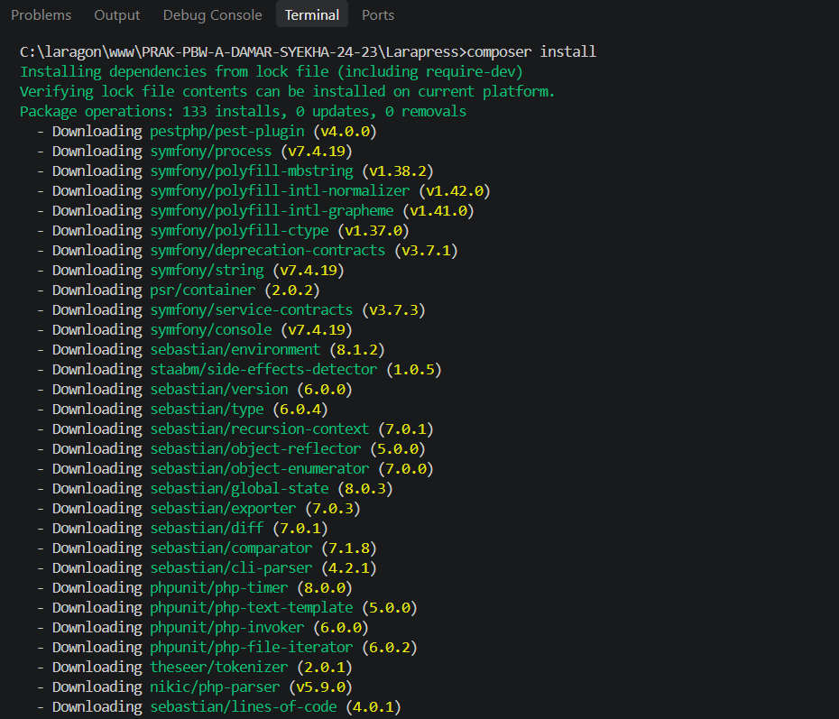

### Langkah 2: Menjalankan Development Server

Masuk ke folder proyek lalu jalankan server bawaan Laravel.

```bash
cd LaraPress
php artisan serve
```

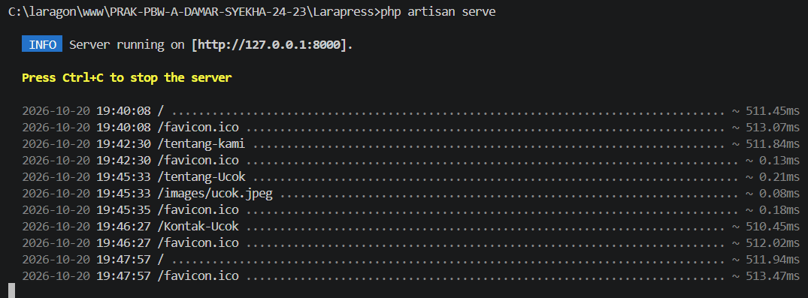

Server aktif di `http://127.0.0.1:8000` dan menampilkan halaman default Laravel.

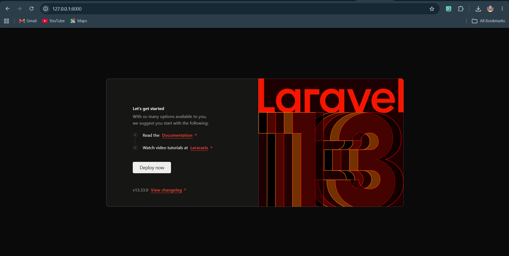

### Langkah 3: Memodifikasi Route dan View Pertama

**Route** di `routes/web.php` berarti: saat URL `/` diakses dengan method GET, tampilkan view `welcome`.

```php
Route::get('/', function () {
    return view('welcome');
});
```

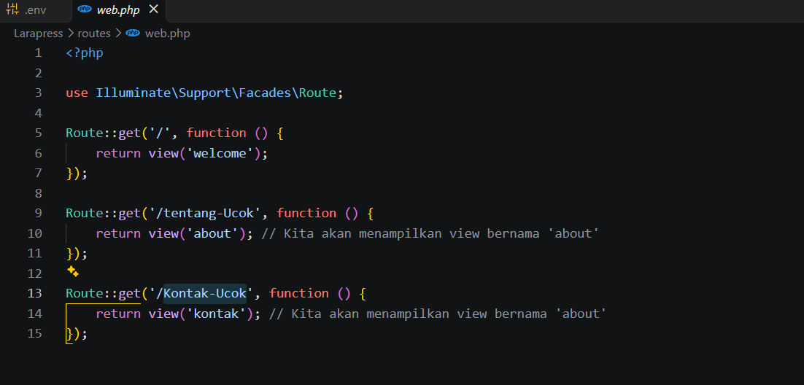

Isi `resources/views/welcome.blade.php` diganti dengan HTML sederhana.

```html
<!DOCTYPE html>
<html>
<head>
    <title>Selamat Datang di LaraPress</title>
</head>
<body>
    <h1>Selamat Datang di Blog LaraPress</h1>
    <p>Ini adalah halaman utama dari aplikasi blog kita.</p>
</body>
</html>
```

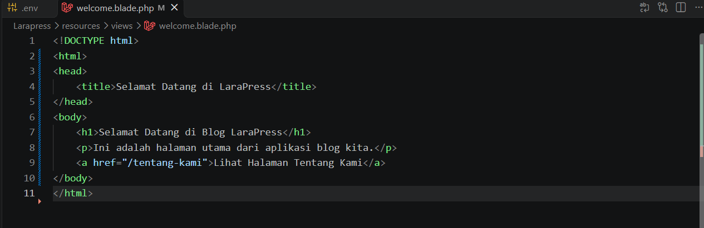

Hasil di browser setelah di-refresh:

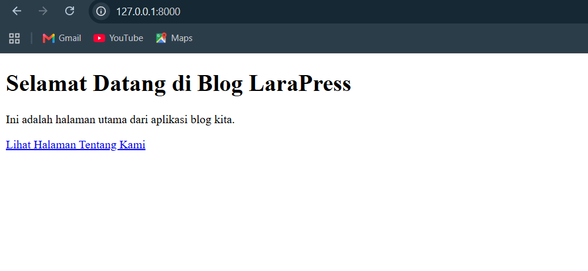

### Langkah 4: Halaman Tentang Kami

**a. Tambah route** di `routes/web.php`:

```php
Route::get('/tentang-kami', function () {
    return view('about');
});
```

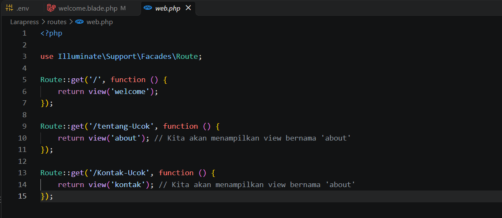

**b. Buat view** `resources/views/about.blade.php`:

```html
<!DOCTYPE html>
<html>
<head>
    <title>Tentang Kami - LaraPress</title>
</head>
<body>
    <h1>Tentang LaraPress</h1>
    <p>LaraPress adalah sebuah proyek blog sederhana yang dibuat untuk mempelajari dasar-dasar framework Laravel 12.</p>
</body>
</html>
```

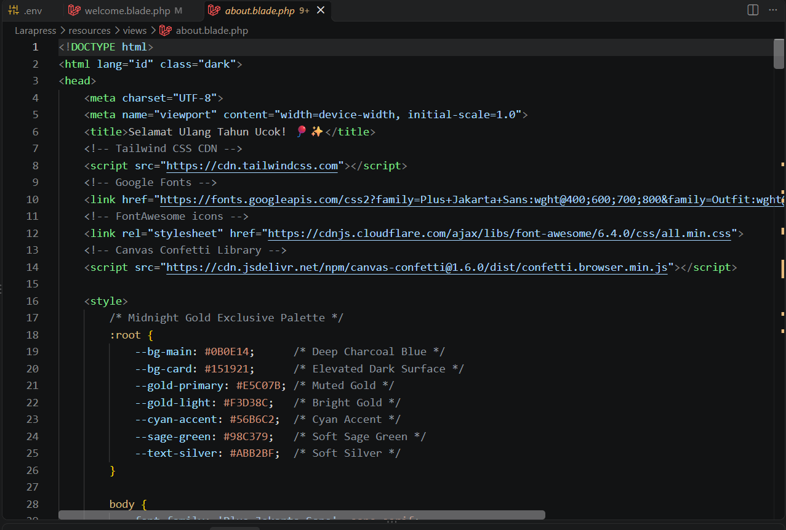

**c. Hasil** di `http://127.0.0.1:8000/tentang-kami`:

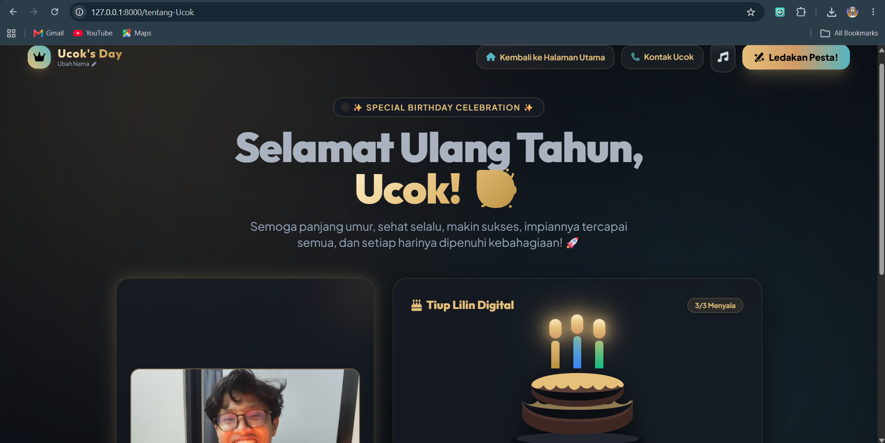

### Langkah 5: Link Navigasi

Link ditambahkan agar pengguna bisa berpindah halaman.

**welcome.blade.php**

```html
<a href="/tentang-kami">Lihat Halaman Tentang Kami</a>
```

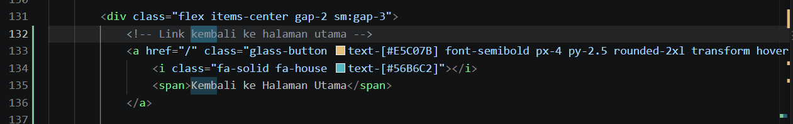

**about.blade.php**

```html
<a href="/">Kembali ke Halaman Utama</a>
```

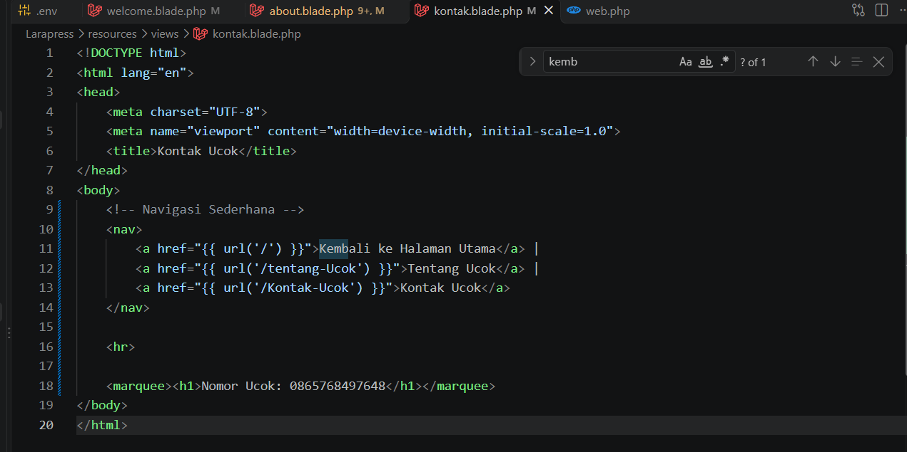

---

## Tugas Mandiri: Halaman Kontak

Membuat halaman statis baru "Kontak" yang bisa diakses lewat `/kontak`, berisi informasi kontak fiktif, dan terhubung dengan halaman lain lewat link navigasi.

**a. Route** di `routes/web.php`:

```php
Route::get('/kontak', function () {
    return view('kontak');
});
```

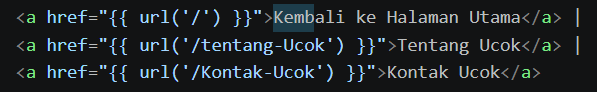

**b. View** `resources/views/kontak.blade.php`:

```html
<!DOCTYPE html>
<html>
<head>
    <title>Kontak - LaraPress</title>
</head>
<body>
    <h1>Kontak Kami</h1>
    <p>Email: info@larapress.test</p>
    <p>Telepon: 0812-3456-7890</p>
    <a href="/">Kembali ke Halaman Utama</a> |
    <a href="/tentang-kami">Tentang Kami</a>
</body>
</html>
```

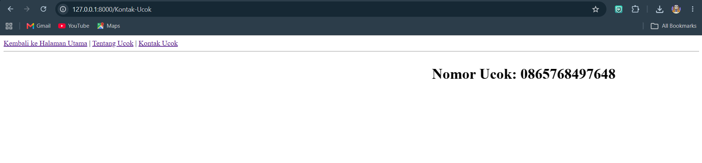


## Kesimpulan

- Proyek Laravel 12 "LaraPress" berhasil dibuat dengan Composer dan dijalankan memakai `php artisan serve`.
- Alur dasar Laravel (**Route → View → Response**) berhasil dipahami dan dipraktikkan.
- Tiga halaman statis berhasil dibuat (Beranda, Tentang Kami, Kontak) dan saling terhubung lewat link navigasi.

---

<p align="center">Disusun oleh <b>Damar Syekha - 4524210023</b></p>
