# Praktikum PBW - A

**Laporan Praktikum 1 : HTTP Method (PHP)**

| | |
|---|---|
| **Nama** | Damar Syekha |
| **NIM** | 4524210023 |
| **Dosen Pengampu** | Bambang Riono Arsad, S.Kom., MMSI |
| **Program Studi** | Teknik Informatika, Universitas Pancasila |
| **Tahun** | 2026-2027 |

---

## Daftar Isi

1. [Instalasi](#instalasi)
2. [Struktur Folder](#struktur-folder)
3. [Pertemuan 1: Menjalankan Contoh Program](#pertemuan-1-menjalankan-contoh-program)
4. [Pertemuan 2: Tugas 1](#pertemuan-2-tugas-1)
   - [Modifikasi Program](#1-modifikasi-program)
   - [Penjelasan 5 Bagian Kode Terpenting](#2-penjelasan-5-bagian-kode-terpenting)
   - [Tampilan Sebelum dan Sesudah Modifikasi](#3-tampilan-sebelum-dan-sesudah-modifikasi)
   - [Error yang Pernah Muncul](#4-error-yang-pernah-muncul)
5. [Kesimpulan](#kesimpulan)

---

## Instalasi

Program ini berjalan di PHP, jadi butuh web server lokal. Di sini dipakai **Laragon** (alternatif: XAMPP).

### Kebutuhan
- Laragon (sudah termasuk Apache + PHP) atau XAMPP
- PHP 8.1 atau lebih baru
- Browser (Chrome/Firefox/Edge)
- Code editor (VS Code)
- Git

### Langkah Instalasi

1. **Download Laragon** (versi Full) di https://laragon.org/download/
2. **Install Laragon**, lalu jalankan aplikasinya.
3. Klik **Start All** sampai Apache dan MySQL berjalan.
4. **Clone repository** ini ke dalam folder `www` Laragon:
```bash
   cd C:\laragon\www
   git clone https://github.com/damar151/PRAK-PBW-A-DAMAR-SYEKHA-24-23.git
```
   (Kalau pakai XAMPP, clone ke `C:\xampp\htdocs\`)
5. **Buka di browser**:
   - Biodata: `http://localhost/PRAK-PBW-A-DAMAR-SYEKHA-24-23/biodata-kalkulator/biodata.php`
   - Kalkulator: `http://localhost/PRAK-PBW-A-DAMAR-SYEKHA-24-23/biodata-kalkulator/kalkulator.php`
   - Biodata (modifikasi): `http://localhost/PRAK-PBW-A-DAMAR-SYEKHA-24-23/biodata-kalkulator/biodataModif.php`
   - Kalkulator (modifikasi): `http://localhost/PRAK-PBW-A-DAMAR-SYEKHA-24-23/biodata-kalkulator/kalkulatorModif.php`

> **Catatan:** Jangan buka file PHP dengan klik dua kali (`file:///...`), karena kode PHP tidak akan dieksekusi. Selalu akses lewat `localhost`.

---

## Struktur Folder

```
biodata-kalkulator/
├── biodata.php           # Program asli (Pertemuan 1)
├── kalkulator.php        # Program asli (Pertemuan 1)
├── biodataModif.php      # Hasil modifikasi
├── kalkulatorModif.php   # Hasil modifikasi
├── images/               # Screenshot untuk laporan
└── README.md
```

---

## Pertemuan 1: Menjalankan Contoh Program

Seluruh contoh program Pertemuan 1 dijalankan ulang dan **berhasil tanpa error kritis**.

### 1. biodata.php

Menampilkan data mahasiswa dari array PHP beserta predikat berdasarkan IPK.

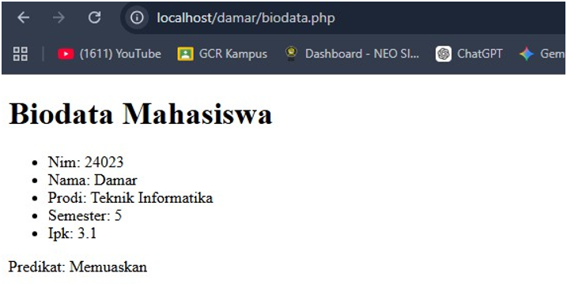

### 2. kalkulator.php

Kalkulator sederhana dengan form `POST` untuk operasi `+`, `-`, `*`, dan `/`.


---

## Pertemuan 2: Tugas 1

### 1. Modifikasi Program

Dibuat lebih dari dua modifikasi bermakna pada kedua program.

#### 1.1 Modifikasi Kalkulator (`kalkulatorModif.php`)

**a. Mempertahankan input pengguna**

Ditambahkan variabel `$input_a`, `$input_b`, dan `$input_op` untuk menyimpan nilai form, supaya angka tidak hilang setelah tombol submit ditekan.

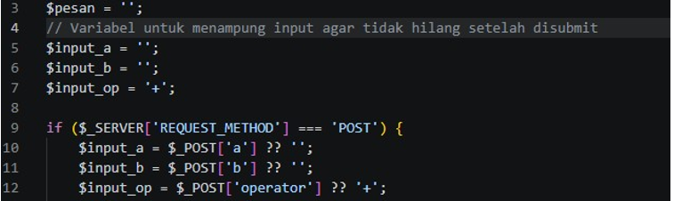

**b. Operator baru dan validasi error**

Ditambahkan operator modulus `%` dan pangkat `**`, serta pesan error jika pembagi bernilai nol.

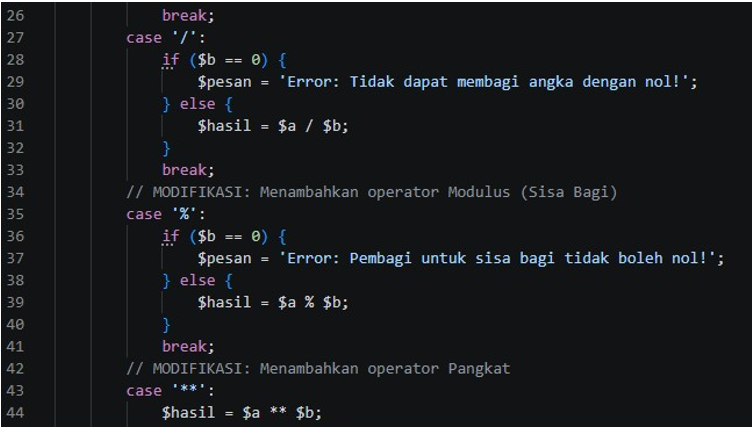

**c. Styling CSS**

Tampilan dibuat berbentuk card, ditambah tombol Reset dan alert untuk hasil/error.

#### 1.2 Modifikasi Biodata (`biodataModif.php`)

**a. Menambah field array**

Ditambahkan field baru `fakultas` pada array `$mahasiswa`.

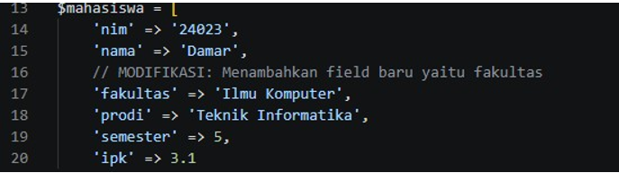

**b. Validasi IPK**

Fungsi `statusKelulusan()` ditambah kondisi untuk menolak IPK yang lebih dari 4.00.

**c. Tampilan card dengan CSS**

CSS dipakai untuk mengubah tampilan teks biasa menjadi card yang rapi dan modern.

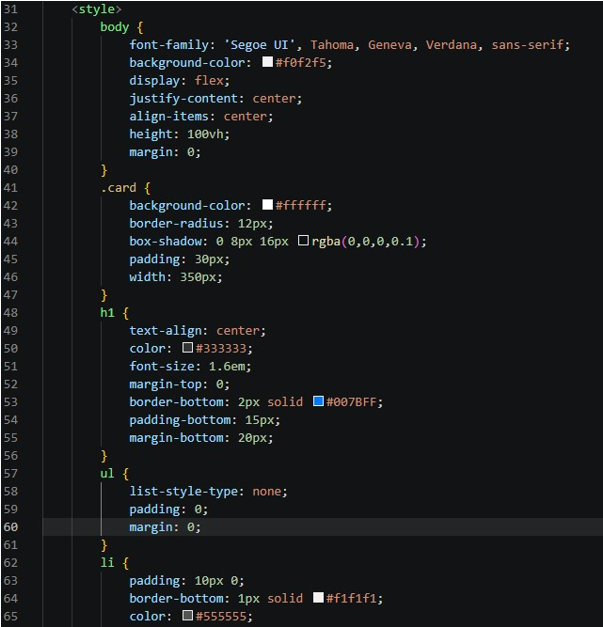

---

### 2. Penjelasan 5 Bagian Kode Terpenting

#### 2.1 Validasi Pembagian Nol (Kalkulator)

Kondisi `if ($b == 0)` mencegah kalkulator error saat pembagian dengan nol. Program menampilkan pesan error yang jelas, bukan crash.

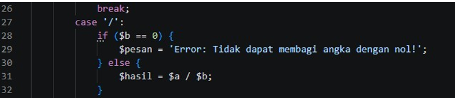

#### 2.2 Mempertahankan Input Pengguna (Kalkulator)

Secara default form akan kosong lagi setelah disubmit. Input disimpan ke variabel lalu dicetak kembali ke atribut `value` di form HTML, jadi pengguna tidak perlu mengetik ulang.

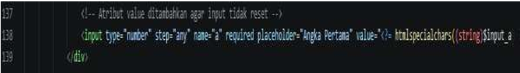

#### 2.3 Validasi Batas Maksimal IPK (Biodata)

Kondisi `if ($ipk > 4.00)` mencegah sistem memberi predikat pada IPK yang tidak masuk akal (di atas batas maksimal 4.00).

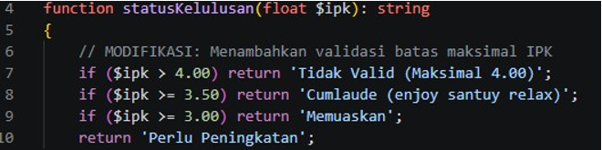

#### 2.4 Penambahan Operator Modulus dan Pangkat (Kalkulator)

Ditambahkan `case '%'` dan `case '**'` pada blok `switch`, sehingga kalkulator bisa menghitung sisa bagi dan perpangkatan.

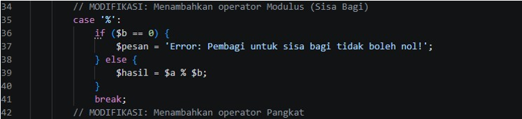

#### 2.5 Keamanan Menampilkan Data (Biodata)

Nilai yang ditampilkan dibungkus `htmlspecialchars()` untuk mencegah serangan XSS, agar karakter khusus tidak dieksekusi sebagai script di browser.

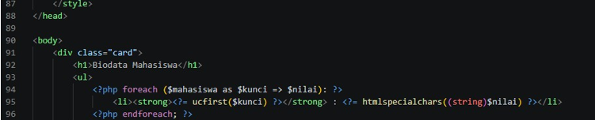

---

### 3. Tampilan Sebelum dan Sesudah Modifikasi

#### 3.1 Kalkulator

**Sebelum (`kalkulator.php`)**


**Sesudah (`kalkulatorModif.php`)**


#### 3.2 Biodata

**Sebelum (`biodata.php`)**

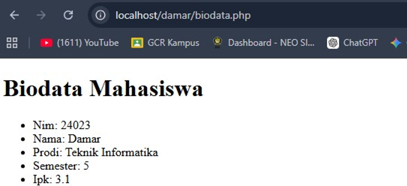

**Sesudah (`biodataModif.php`)**

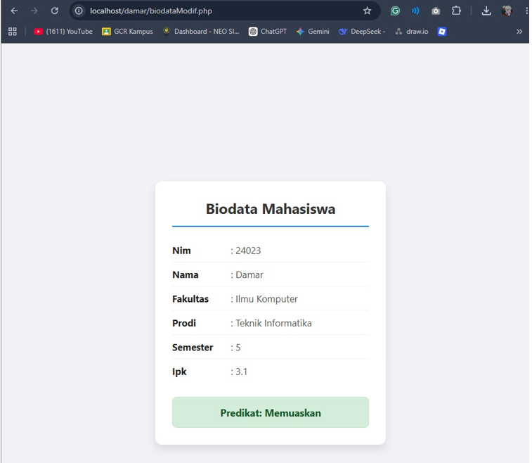

---

### 4. Error yang Pernah Muncul

**Pesan error:**

```
Deprecated: Implicit conversion from float 2.5 to int loses precision
in C:\laragon\www\damar\kalkulatorModif.php on line 39
```

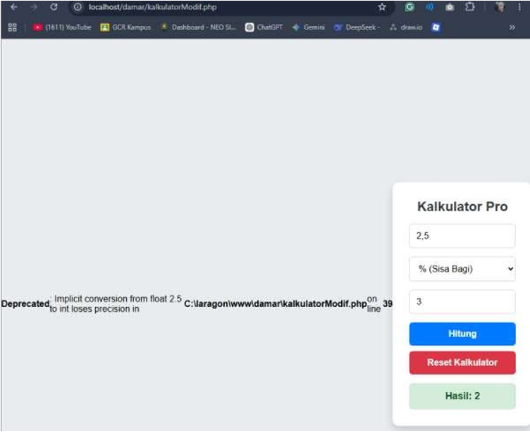

**Penyebab:**
Error muncul saat menguji operasi modulus dengan angka desimal (Angka Pertama `2.5`, Angka Kedua `3`). Di PHP, operator `%` hanya untuk bilangan bulat (integer). Saat diberi float, PHP memotong `2.5` menjadi `2` sebelum menghitung, sehingga muncul peringatan *loses precision* (kehilangan presisi).

**Kode penyebab:**

```php
case '%':
    if ($b == 0) {
        $pesan = 'Error: Pembagi untuk sisa bagi tidak boleh nol!';
    } else {
        $hasil = $a % $b;   // <-- penyebab error
    }
    break;
```

**Langkah perbaikan:**
Operator `%` diganti dengan fungsi bawaan PHP `fmod()`, yang memang dibuat untuk modulus bilangan desimal tanpa memotong presisi.

```php
case '%':
    if ($b == 0) {
        $pesan = 'Error: Pembagi untuk sisa bagi tidak boleh nol!';
    } else {
        $hasil = fmod($a, $b);   // <-- perbaikan
    }
    break;
```

**Hasil setelah diperbaiki:** error hilang dan hasil `2.5 % 3` tampil benar yaitu `2.5`.

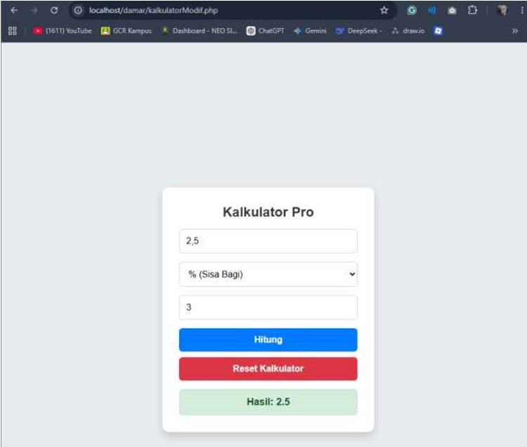

---

## Kesimpulan

- Seluruh contoh Pertemuan 1 (`biodata.php` dan `kalkulator.php`) berjalan tanpa error kritis.
- Program berhasil dimodifikasi dengan fitur baru (field `fakultas`, operator `%` dan `**`), validasi (pembagian nol, IPK maksimal 4.00), serta peningkatan styling CSS.
- Error `Deprecated: Implicit conversion from float to int` berhasil diperbaiki dengan menggunakan `fmod()`.

---

<p align="center">Disusun oleh <b>Damar Syekha - 4524210023</b></p>
